# Cloud PBX Deployment: Touch Domain

**Touch Domain designed, deployed and secured its own cloud-hosted business phone system. It runs FreePBX 17 on a Debian 12 server in South Africa, connected to a Switch Telecom SIP trunk on a 053 geographic number.**

The system went from order to live inbound and outbound calls in six days. It costs **under R500 a month** in total.

| | |
| --- | --- |
| **Client** | TOUCHDOMAIN (Pty) Ltd |
| **Delivered** | October 2026 |
| **Scope** | Server build and hardening, PBX, SIP trunk, call routing, softphones, security |
| **Outcome** | Internal, outbound and inbound calling live on a geographic business number |

## The brief

Deliver a business-grade phone system with these requirements:

- A local geographic number, presented as caller ID on outgoing calls
- Calls answered on a laptop and a mobile phone, from anywhere
- No on-site hardware and no per-user switchboard licences
- Predictable, low monthly cost, and full ownership of the configuration
- Secure by default against the toll-fraud and scanning attacks common on internet-facing VoIP

## Architecture

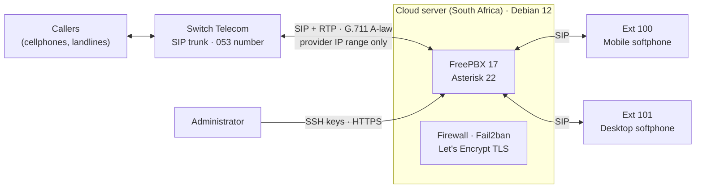

| Layer | Choice | Why |
| --- | --- | --- |
| Carrier | Switch Telecom SIP trunk: 4 channels, per-second billing | Local carrier with geographic numbers and no long contract |
| Hosting | HostAfrica cloud server in South Africa: 1 vCPU, 2 GB RAM | Local data centre keeps latency to the carrier at about 2 ms |
| PBX | FreePBX 17 / Asterisk 22 on Debian 12 | Open source and widely supported, with no licence fees |
| Endpoints | Zoiper (mobile) and MicroSIP (desktop) | Free, standards-based softphones |

## Cost

| Item | Per month |
| --- | --- |
| SIP trunk line fee | R115 |
| Call credit (usage-based) | R100 |
| Cloud server (incl. VAT) | about R250 |
| **Total** | **about R465** |

## Delivery

**1. Server build and hardening.** I built a Debian 12 server with a dedicated admin account and SSH key authentication. Password and root logins are disabled.

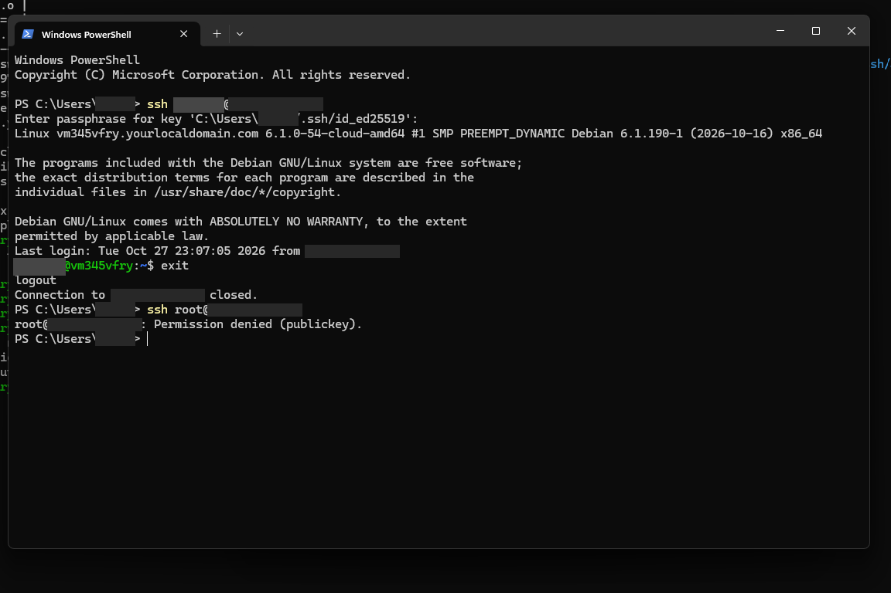

**2. PBX installation.** I installed FreePBX 17 and Asterisk 22 and verified the services.

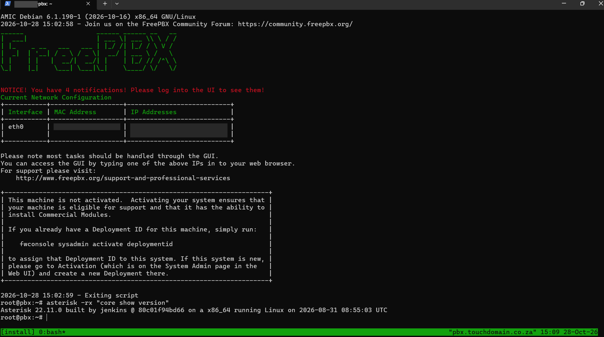
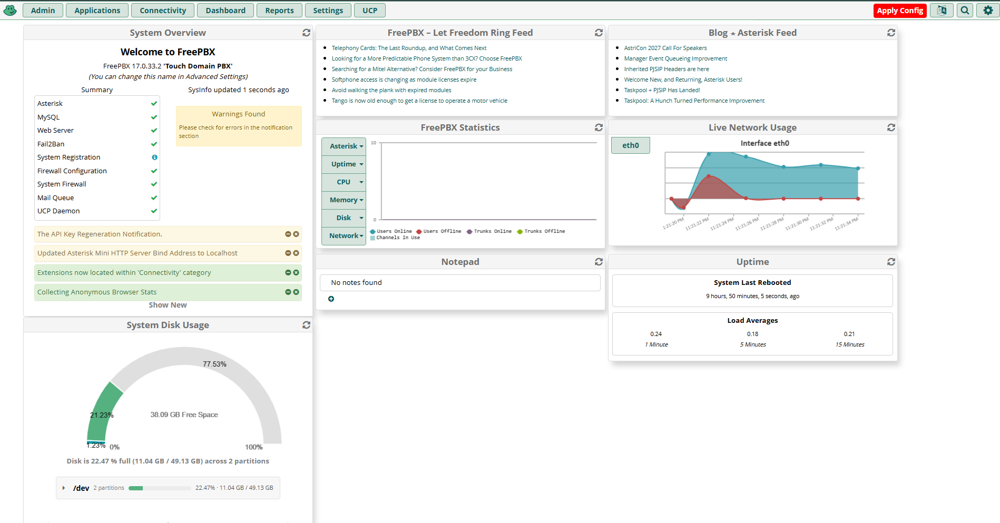

**3. Security layer.** I applied a default-deny firewall with Responsive Firewall for SIP clients. I added Fail2ban intrusion prevention and a Let's Encrypt TLS certificate for the admin interface, with automated renewal.

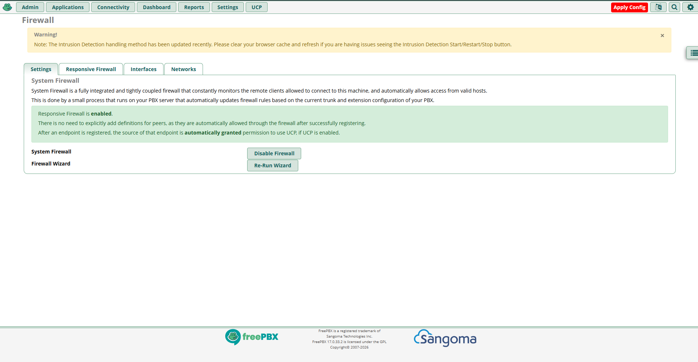
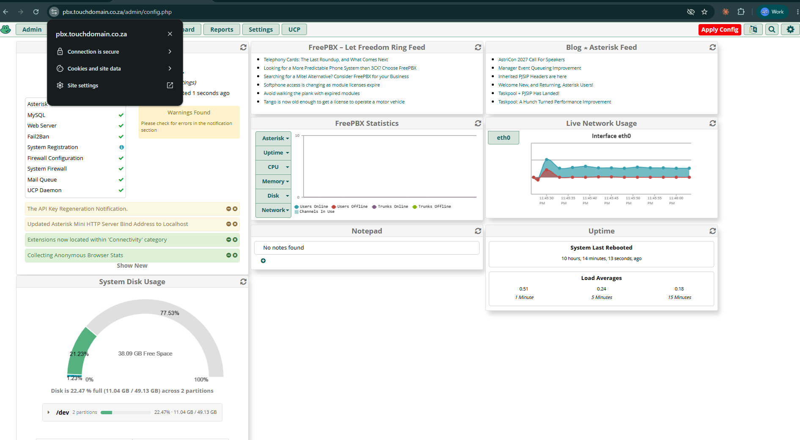

**4. Extensions and endpoints.** I provisioned PJSIP extensions for mobile and desktop and validated internal calls. The first test call ran for over 5 minutes.

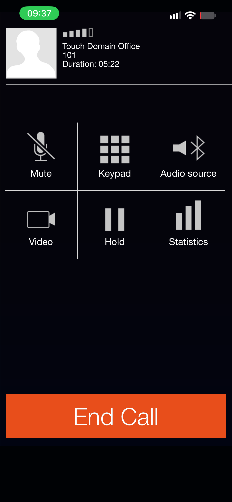

**5. Carrier integration.** I set up a PJSIP trunk with outbound registration and A-law only. It accepts traffic from the carrier's IP range only. Both sides confirm it is registered, with 2 ms latency.

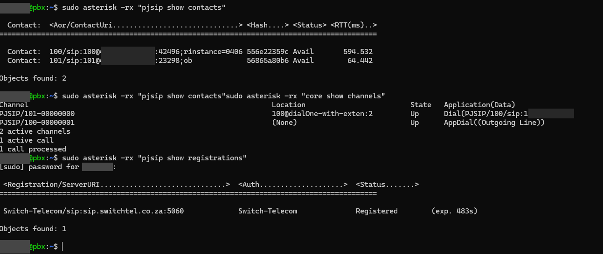
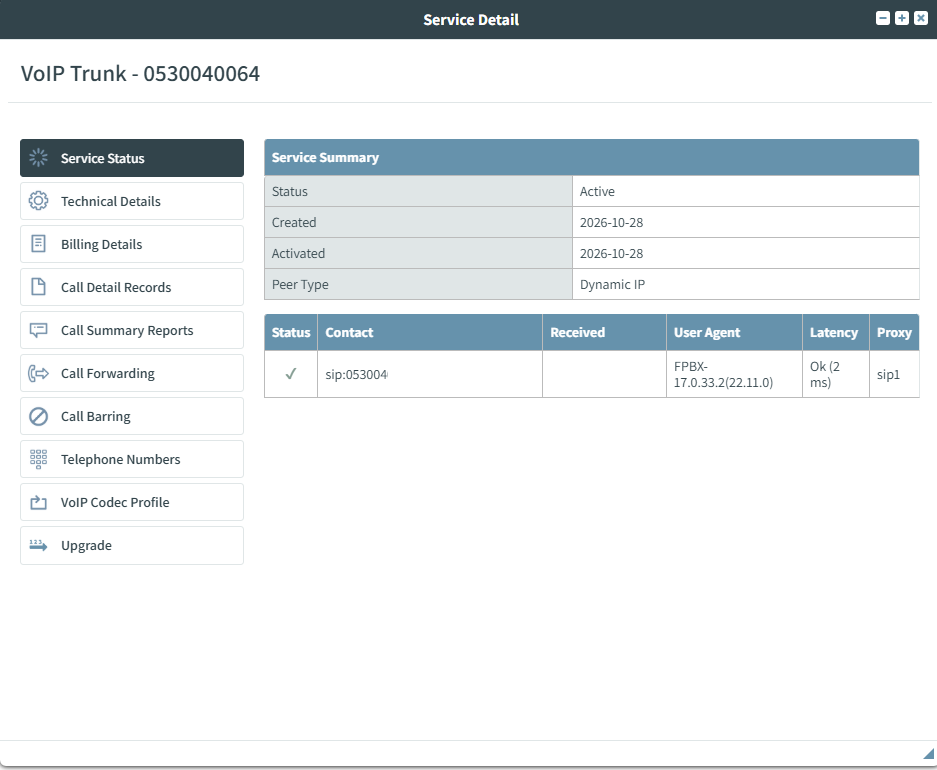

**6. Call routing and go-live.** I set up outbound routes for South African numbers and emergency services, and an inbound route from the 053 number to the office extension. The carrier then locked the trunk to the server's IP address.

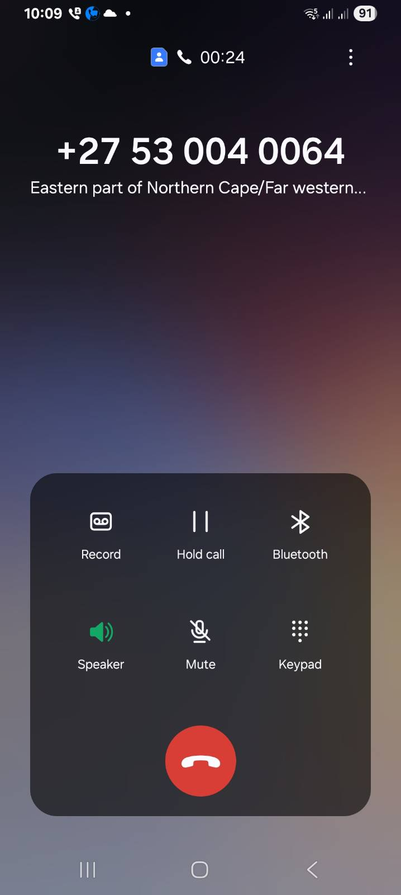
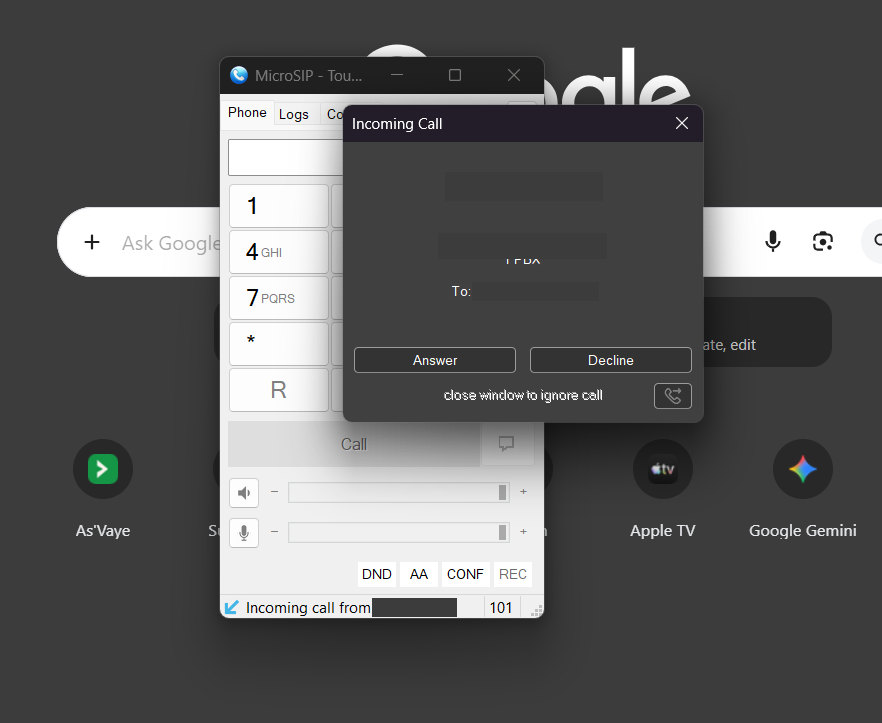

## Challenges and resolutions

| Challenge | Resolution |
| --- | --- |
| The installer stopped when the vendor's module mirror returned an empty reply | Diagnosed the cURL 52 error, re-ran the module upgrade, and completed the installation safely |
| The cloud provider's provisioning reset the hosts file on every reboot | Traced it to cloud-init user-data and fixed it in the cloud-init template, so the fix survives reboots and rebuilds |
| The firewall was left half-applied after a setup wizard error | Confirmed from the command line that the firewall was inactive, enabled it properly, and verified the rule set |
| The premium HTTPS module needs a paid licence | Applied the Let's Encrypt certificate to Apache directly, with a scheduled reload to pick up renewals |
| Internet SIP scanners attempted registrations within hours of the PBX going online | Fail2ban banned them automatically. Trusted networks are whitelisted, so legitimate users are never blocked |
| A softphone with a malformed SIP username triggered an automatic ban | Traced it in the Asterisk logs to a duplicated domain in the SIP URI, corrected the client profile, and set up an admin whitelist |
| iOS suspends background apps, so mobile extensions drop offline | Confirmed with SIP keep-alive (qualify) checks and specified a push-notification softphone for production mobile use |
| The administrator's internet IP is dynamic | Designed admin access to survive IP changes without weakening the firewall |

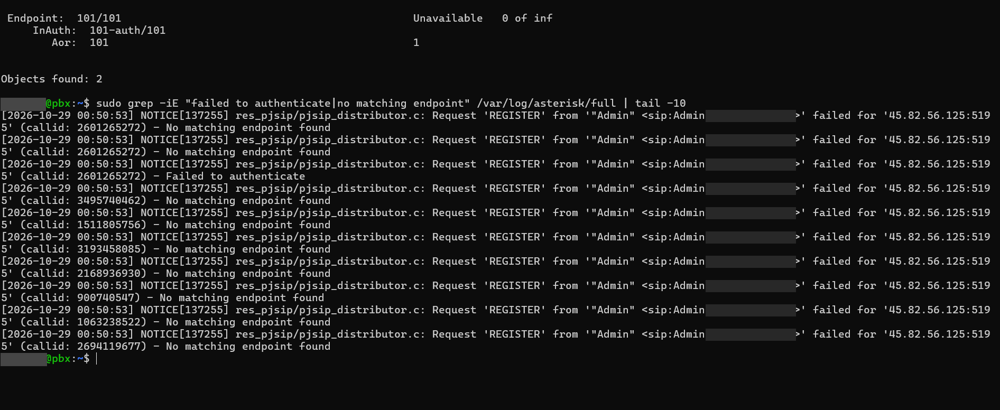
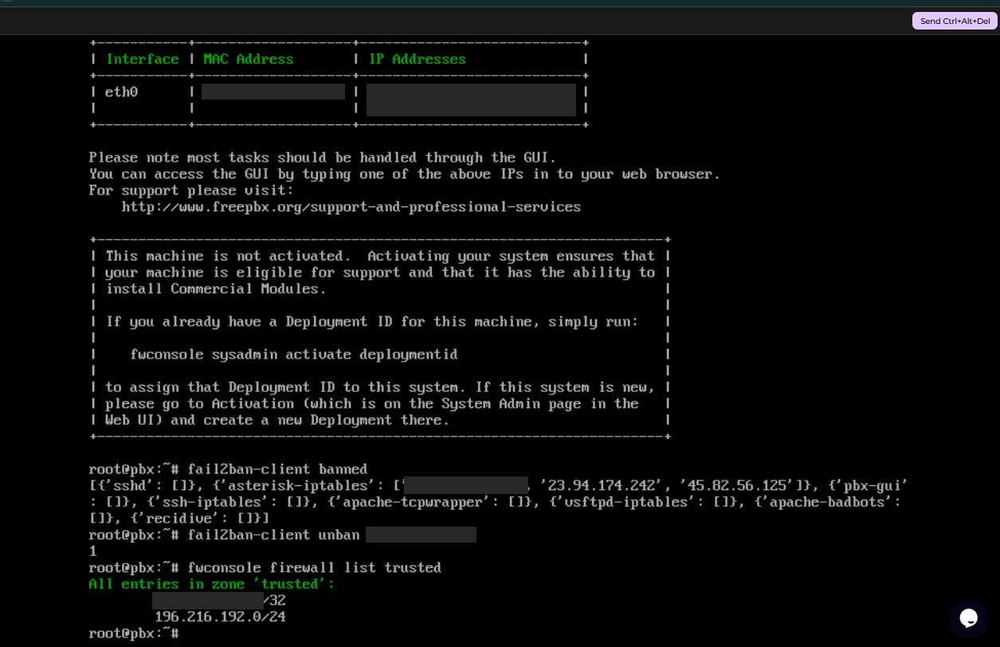
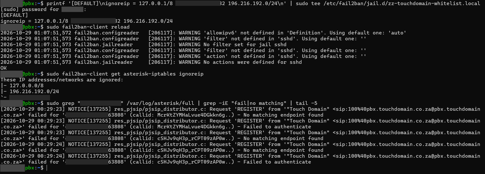
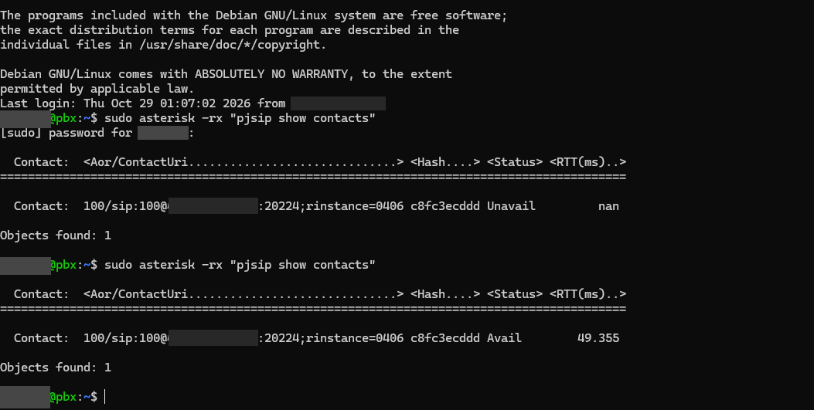

## Security controls

- SSH accepts keys only, with root and password logins disabled
- The firewall denies by default, and the admin interface is restricted to trusted networks
- The trunk is locked both ways: the PBX accepts only the carrier's IP range, and the carrier accepts only the PBX's IP
- Fail2ban bans IPs after repeated failed SIP registrations
- The admin interface uses TLS with automated certificate renewal
- International dialling is barred at the carrier to limit toll-fraud exposure
- No credentials or secrets are published in this repository

## Roadmap

- Push-notification softphones for mobile extensions
- A ring group across all devices, with voicemail fallback
- A VPN for administrative access

## Repository

- `screenshots/`: redacted evidence of each stage
- `configs/`: sanitised configuration snippets
- `docs/`: carrier network requirements and the architecture diagram
